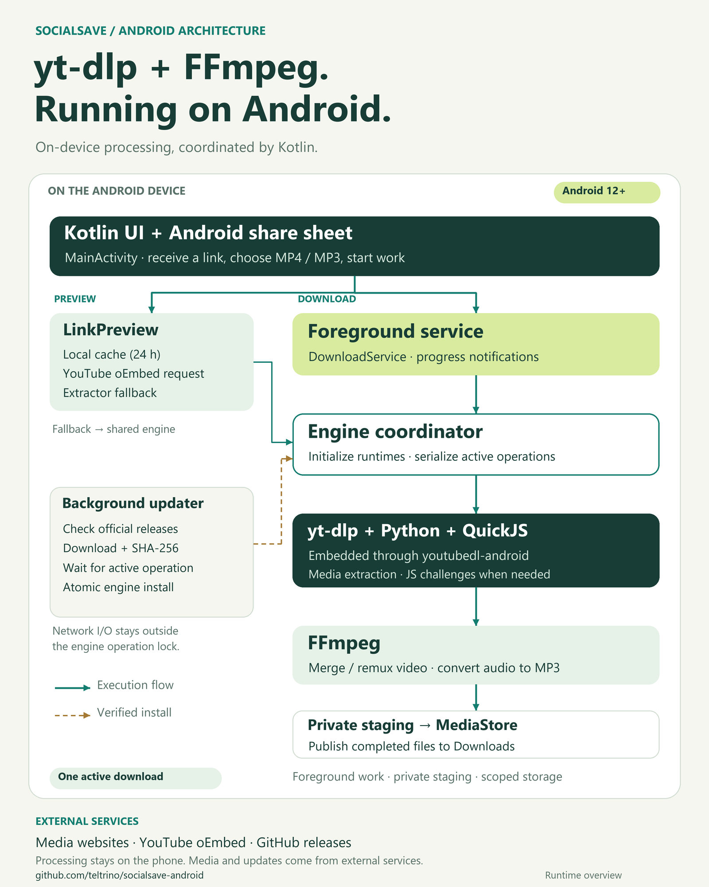
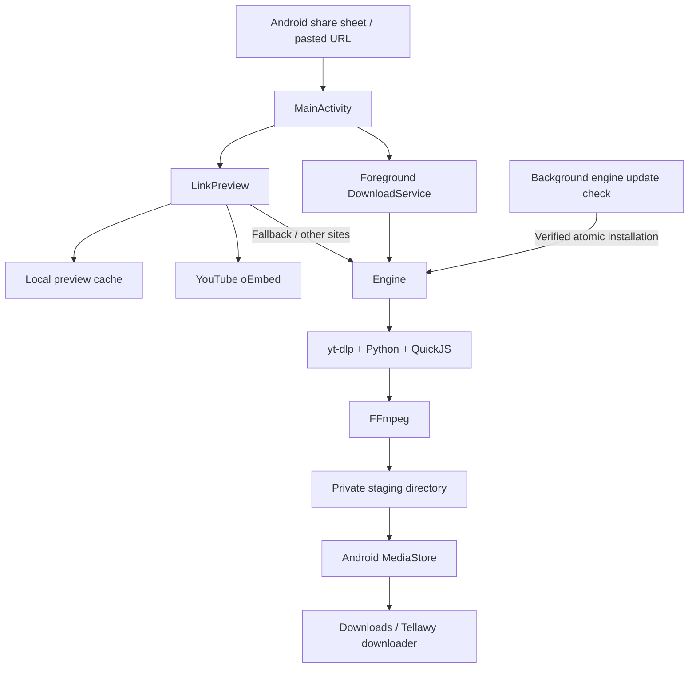

# Architecture

SocialSave for Android (distributed as Tellawy downloader) is a native Kotlin app. Extraction and media processing run on the device, without an application backend. Media websites, YouTube oEmbed, and GitHub releases remain external services.

[Full-size PNG](images/socialsave-runtime.png) · [Editable SVG](images/socialsave-runtime.svg)

The diagram shows the runtime boundaries and execution flow. The updater downloads outside the engine lock; verified installation waits for an active engine operation to finish.

Text-based flow (Mermaid)

| Component | Responsibility |
| --- | --- |
| `MainActivity` | English UI, shared text, separate audio/video quality selectors, debounced previews, and copyable errors. |
| `LinkPreview` / `YouTubeLink` | Lightweight YouTube metadata, canonical IDs, a bounded 24-hour local cache, and extractor fallback. |
| `Engine` | Native runtime initialization, requests, disk caching, serialized extraction/installation, and checksum-verified updates. |
| `DownloadService` | One foreground operation, notifications, retry/re-extraction, FFmpeg processing, and MediaStore publishing. |
| `DownloadSettings` / `NetworkFailure` | Format selectors and network failure classification. |

Previewing a YouTube link does not require full format extraction. Update network requests do not hold the extraction lock; installation waits for an active extraction, then atomically replaces the verified engine file. Media is staged privately, copied to a pending MediaStore item, and made visible only on success.

Transient failures can trigger one fresh extraction using IPv4. Resolution is a maximum, and available source formats determine actual quality. Increasing MP3 bitrate cannot restore quality absent from the source.

There is no persistent queue, pause/resume UI, account/cookie import, playlist support, or restart after a force-stop. The Activity builds views programmatically; a component-based UI and persistent job model are possible future improvements.

The historical package ID `com.sahab.downloader` is retained so existing installations can receive signed updates.
